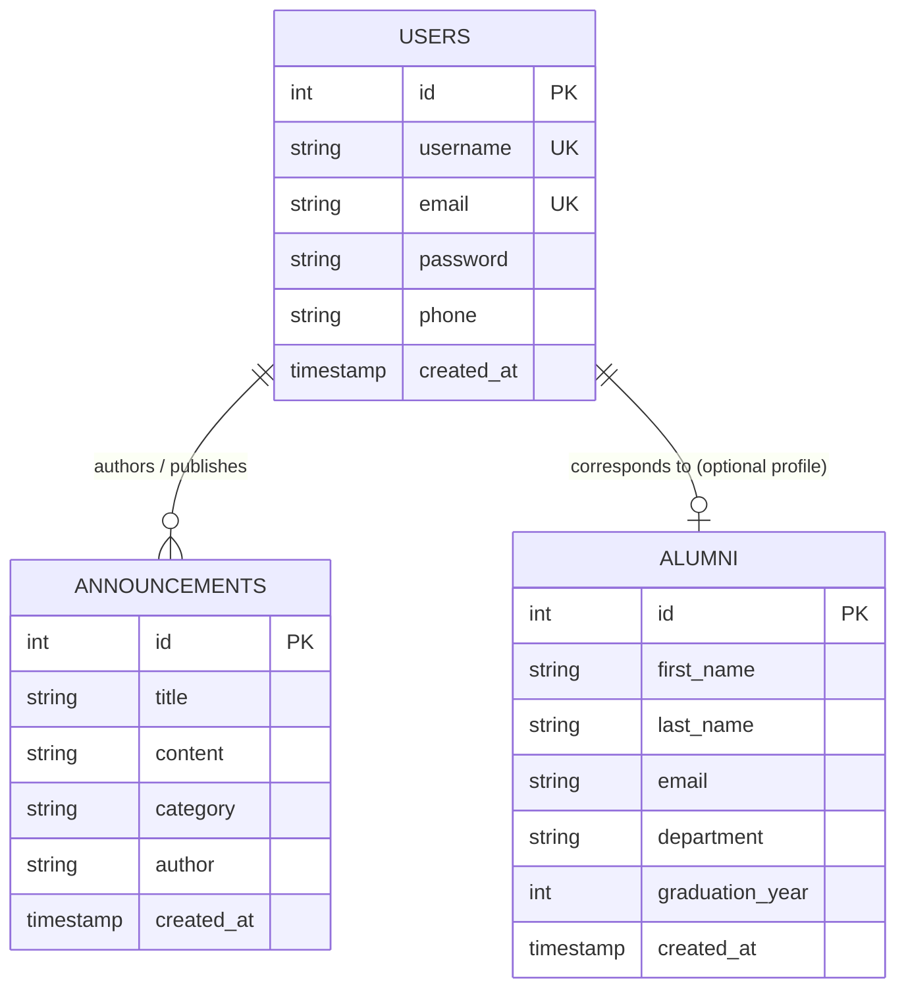

# Data Design Documentation (DDD)

## 📌 1. Project Overview & Objective

This document defines the **Data Design Documentation (DDD)** for the **Alumni Management System**. It specifies the data models, storage mechanisms, lifecycle of records, relational schemas, and persistence strategies across containerized environments.

---

## 🔬 2. Persistence Analysis: "The Forgetting Test"

During system verification, the **Forgetting Test** was executed to evaluate data durability:

1. **Test Execution:**
   - Create a new record via the user interface or API.
   - Execute `docker compose down` (terminates containers and cleans process memory).
   - Execute `docker compose up -d` (restarts services).
   - Query the record list.

2. **Findings & Principle:**
   - **In-Memory Storage (Ephemeral):** Records stored solely in process RAM (e.g., JavaScript memory arrays) are **lost/forgotten** upon restart. Hardcoded seed data reappears because it is re-initialized by the class constructor.
   - **Database with Docker Volumes (Persistent):** Records stored in the relational database (MySQL) mapped to a Docker named volume (`db_data`) persist permanently across container stops, restarts, and re-deployments.

```
┌────────────────────────────────────────────────────────┐
│                   IN-MEMORY (EPHEMERAL)                │
│  HTTP Request ──► Controller ──► Model (RAM Array)     │
│  * Container Restart ──► DATA IS LOST (FORGOTTEN)      │
└────────────────────────────────────────────────────────┘

┌────────────────────────────────────────────────────────┐
│                 PERSISTENT (DATABASE + VOLUME)         │
│  HTTP Request ──► Controller ──► Model ──► MySQL       │
│                                              │         │
│                                    Docker Volume       │
│                                     (db_data disk)     │
│  * Container Restart ──► DATA IS PRESERVED             │
└────────────────────────────────────────────────────────┘
```

---

## 🗄️ 3. Entity Definitions & Schema Specifications

The system operates around three core data entities: **Users**, **Alumni**, and **Announcements**.

### 3.1. Users Entity (`users` table)
Stores registered users, administrative accounts, and authentication attributes.

| Field Name | Data Type | Constraints | Description |
|---|---|---|---|
| `id` | `INT` | `PRIMARY KEY`, `AUTO_INCREMENT` | Unique identifier for each user |
| `username` | `VARCHAR(50)` | `NOT NULL`, `UNIQUE` | Unique handle/login username |
| `email` | `VARCHAR(150)` | `NOT NULL`, `UNIQUE` | Unique user email address |
| `password` | `VARCHAR(255)` | `NOT NULL` | Account password |
| `phone` | `VARCHAR(20)` | `NULLABLE` | Contact telephone number |
| `created_at` | `TIMESTAMP` | `DEFAULT CURRENT_TIMESTAMP` | Account creation timestamp |

### 3.2. Alumni Entity (`alumni` table)
Stores university graduates, academic records, and department associations.

| Field Name | Data Type | Constraints | Description |
|---|---|---|---|
| `id` | `INT` | `PRIMARY KEY`, `AUTO_INCREMENT` | Unique identifier for alumni entry |
| `first_name` | `VARCHAR(100)` | `NOT NULL` | First name of graduate |
| `last_name` | `VARCHAR(100)` | `NOT NULL` | Last name of graduate |
| `email` | `VARCHAR(150)` | `NULLABLE` | Contact email address |
| `department` | `VARCHAR(150)` | `NULLABLE` | Graduated academic department |
| `graduation_year`| `INT` | `NULLABLE` | Calendar year of graduation (e.g., 2024) |
| `created_at` | `TIMESTAMP` | `DEFAULT CURRENT_TIMESTAMP` | Record registration timestamp |

### 3.3. Announcements Entity (`announcements` table - Homework)
Stores campus updates, career opportunities, and alumni networking announcements.

| Field Name | Data Type | Constraints | Description |
|---|---|---|---|
| `id` | `INT` | `PRIMARY KEY`, `AUTO_INCREMENT` | Unique identifier for announcement |
| `title` | `VARCHAR(200)` | `NOT NULL` | Header/title of the announcement |
| `content` | `TEXT` | `NOT NULL` | Full announcement text / description |
| `category` | `VARCHAR(50)` | `NOT NULL` | Category: `General`, `Event`, `Career`, `Mentorship` |
| `author` | `VARCHAR(100)` | `NOT NULL` | Issuing office or individual name |
| `created_at` | `TIMESTAMP` | `DEFAULT CURRENT_TIMESTAMP` | Publication timestamp |

---

## 📊 4. Entity-Relationship Diagram (ERD)



---

## 🔄 5. Data Flow & CRUD Mapping

| Operation | HTTP Verb | Route | Target Entity | Data Action |
|---|---|---|---|---|
| **Create** | `POST` | `/users` or `/api/users` | `User` | Inserts new user record |
| **Read (All)** | `GET` | `/users` or `/api/users` | `User` | Queries full collection |
| **Read (One)** | `GET` | `/api/users/:id` | `User` | Queries single record by PK |
| **Update (Full)**| `PUT` | `/api/users/:id` | `User` | Overwrites all record attributes |
| **Update (Partial)**| `PATCH` | `/api/users/:id` | `User` | Mutates only specified fields |
| **Delete** | `DELETE`/`POST` | `/users/:id/delete` | `User` | Removes record by PK |
| **Create** | `POST` | `/announcements` | `Announcement`| Inserts new announcement |
| **Read** | `GET` | `/announcements` | `Announcement`| Lists announcements |
| **Update** | `POST`/`PUT` | `/announcements/:id/update` | `Announcement`| Updates announcement |
| **Delete** | `POST`/`DELETE`| `/announcements/:id/delete` | `Announcement`| Deletes announcement |

---

## 🛡️ 6. Data Integrity & Validation Rules

1. **Uniqueness:**
   - `users.username` and `users.email` are enforced as unique to prevent duplicate identities.
2. **Nullability:**
   - Core identifiers and security credentials (`username`, `email`, `password`, `title`, `content`) cannot be `NULL`.
3. **Storage Boundary:**
   - Passwords must be hashed prior to persistent storage.
   - Categorical fields in announcements are validated against predefined enums (`General`, `Event`, `Career`, `Mentorship`).
