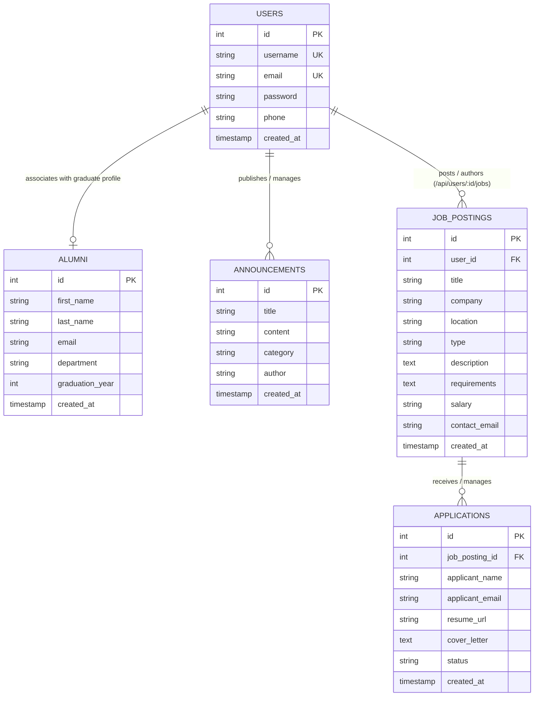

# Data Design Documentation (DDD)

## 📌 1. Overview & Scope

This document specifies the **Data Design Documentation (DDD)** for the **Alumni Management System**. It outlines the conceptual, logical, and physical data architecture, relational schemas, entity relationships, integrity constraints, and persistence strategies.

> 📖 **Project README:** See the main [Project README (README.md)](./README.md) for application setup, MVC architecture, and complete endpoint listings.
> 🔑 **Environment Configuration:** See [.example.env](./.example.env) for environment variable references.

---

## 🏗️ 2. Storage & Persistence Architecture

The system utilizes a containerized relational database architecture designed for high integrity and durable storage across application lifecycles.

```
┌────────────────────────────────────────────────────────┐
│                   APPLICATION TIER                     │
│  Express.js Engine ──► MVC Controller ──► Data Models  │
└───────────────────────────┬────────────────────────────┘
                            │ SQL Queries (mysql2 pool)
┌───────────────────────────▼────────────────────────────┐
│                    DATABASE TIER                       │
│  MySQL 8.0 Engine (InnoDB)                             │
│  Database Name: alumni_db                              │
└───────────────────────────┬────────────────────────────┘
                            │ Persistent Block Storage
┌───────────────────────────▼────────────────────────────┐
│                    STORAGE TIER                        │
│  Docker Volume: db_data (/var/lib/mysql)               │
│  * Ensures complete non-volatile data persistence       │
└────────────────────────────────────────────────────────┘
```

- **Database Engine:** MySQL 8.0 (InnoDB storage engine supporting ACID transactions and relational constraints).
- **Persistence Mechanism:** Named Docker volume (`db_data`) mapped to `/var/lib/mysql` guarantees permanent data retention across container lifecycle events.
- **Connection Management:** Connection pool (`mysql2/promise`) configured with environment-based configuration parameters.

---

## 🗄️ 3. Entity Definitions & Schema Specifications

The database schema consists of five primary tables: `users`, `alumni`, `announcements`, `job_postings`, and `applications`.

### 3.1. Users Entity (`users` table)
Maintains user credentials, administrative accounts, and contact identities.

| Column Name | Data Type | Key / Constraint | Description |
|---|---|---|---|
| `id` | `INT` | `PK`, `AUTO_INCREMENT` | Unique numeric identifier for the user |
| `username` | `VARCHAR(50)` | `NOT NULL`, `UNIQUE` | Unique user handle / authentication username |
| `email` | `VARCHAR(150)` | `NOT NULL`, `UNIQUE` | Unique email address for communication |
| `password` | `VARCHAR(255)` | `NOT NULL` | Hashed password string |
| `phone` | `VARCHAR(20)` | `NULL` | Optional contact telephone number |
| `created_at` | `TIMESTAMP` | `DEFAULT CURRENT_TIMESTAMP` | System record creation timestamp |

### 3.2. Alumni Entity (`alumni` table)
Maintains graduate records, departments, and academic completion milestones.

| Column Name | Data Type | Key / Constraint | Description |
|---|---|---|---|
| `id` | `INT` | `PK`, `AUTO_INCREMENT` | Unique identifier for alumni record |
| `first_name` | `VARCHAR(100)` | `NOT NULL` | Legal first name of graduate |
| `last_name` | `VARCHAR(100)` | `NOT NULL` | Legal last name of graduate |
| `email` | `VARCHAR(150)` | `NULL` | Contact email address |
| `department` | `VARCHAR(150)` | `NULL` | Academic department of graduation |
| `graduation_year`| `INT` | `NULL` | Four-digit calendar year of graduation |
| `created_at` | `TIMESTAMP` | `DEFAULT CURRENT_TIMESTAMP` | System registration timestamp |

### 3.3. Announcements Entity (`announcements` table)
Maintains institutional bulletins, career notices, and alumni networking announcements.

| Column Name | Data Type | Key / Constraint | Description |
|---|---|---|---|
| `id` | `INT` | `PK`, `AUTO_INCREMENT` | Unique identifier for announcement |
| `title` | `VARCHAR(200)` | `NOT NULL` | Headline / subject of announcement |
| `content` | `TEXT` | `NOT NULL` | Full body text of the bulletin |
| `category` | `VARCHAR(50)` | `NOT NULL` | Categorization: `General`, `Event`, `Career`, `Mentorship` |
| `author` | `VARCHAR(100)` | `NOT NULL` | Publishing entity, office, or individual |
| `created_at` | `TIMESTAMP` | `DEFAULT CURRENT_TIMESTAMP` | Publication timestamp |

### 3.4. Job Postings Entity (`job_postings` table)
Maintains professional employment vacancies, corporate job openings, and internship opportunities for alumni.

| Column Name | Data Type | Key / Constraint | Description |
|---|---|---|---|
| `id` | `INT` | `PK`, `AUTO_INCREMENT` | Unique identifier for the job vacancy |
| `user_id` | `INT` | `NULL`, `FK -> users(id)` | Author/publisher user identifier (supports `/api/users/:id/jobs`) |
| `title` | `VARCHAR(200)` | `NOT NULL` | Position title (e.g. Senior Backend Engineer) |
| `company` | `VARCHAR(150)` | `NOT NULL` | Hiring organization or employer name |
| `location` | `VARCHAR(150)` | `NOT NULL` | Geographic location or work arrangement (e.g. Istanbul, Remote) |
| `type` | `VARCHAR(50)` | `DEFAULT 'Full-time'` | Employment arrangement: `Full-time`, `Part-time`, `Internship`, `Remote` |
| `description` | `TEXT` | `NOT NULL` | Comprehensive role responsibilities and summary |
| `requirements` | `TEXT` | `NULL` | Desired qualifications, tech stack, and prerequisites |
| `salary` | `VARCHAR(100)` | `NULL` | Compensation range or terms |
| `contact_email` | `VARCHAR(150)` | `NULL` | Recruiter or inquiry contact address |
| `created_at` | `TIMESTAMP` | `DEFAULT CURRENT_TIMESTAMP` | Job posting listing timestamp |

### 3.5. Applications Entity (`applications` table)
Maintains candidate applications submitted by alumni for specific job openings, establishing a direct relational link to `job_postings`.

| Column Name | Data Type | Key / Constraint | Description |
|---|---|---|---|
| `id` | `INT` | `PK`, `AUTO_INCREMENT` | Unique numeric identifier for the application |
| `job_posting_id` | `INT` | `NOT NULL`, `FK -> job_postings(id)` | Foreign key referencing the parent job posting |
| `applicant_name` | `VARCHAR(150)` | `NOT NULL` | Full legal name of candidate |
| `applicant_email` | `VARCHAR(150)` | `NOT NULL` | Candidate email address for correspondence |
| `resume_url` | `VARCHAR(255)` | `NULL` | Link or storage reference to applicant CV/portfolio |
| `cover_letter` | `TEXT` | `NULL` | Candidate statement or motivation letter |
| `status` | `VARCHAR(50)` | `DEFAULT 'Pending'` | Workflow stage: `Pending`, `Reviewing`, `Accepted`, `Rejected` |
| `created_at` | `TIMESTAMP` | `DEFAULT CURRENT_TIMESTAMP` | Application submission timestamp |

---

## 📊 4. Entity-Relationship Diagram (ERD)



---

## 🛡️ 5. Data Integrity & Constraint Rules

1. **Entity Integrity:**
   - Every table mandates an auto-incrementing surrogate primary key (`id`) guaranteeing unique tuple access.
2. **Referential Integrity & Cascading:**
   - `job_postings.user_id` enforces a foreign key constraint referencing `users.id` with `ON DELETE SET NULL`, preserving job history while establishing authorship.
   - `applications.job_posting_id` enforces a foreign key constraint referencing `job_postings.id` with `ON DELETE CASCADE`, ensuring no orphaned applications persist when a job posting is removed.
3. **Domain Integrity:**
   - `users.email`, `alumni.email`, `job_postings.contact_email`, and `applications.applicant_email` adhere to standard RFC-compliant electronic mail format.
   - `alumni.graduation_year` accepts valid numeric integer values representing calendar years.
   - `announcements.category` is constrained to defined domain values (`General`, `Event`, `Career`, `Mentorship`).
   - `job_postings.type` defaults to `Full-time` and accepts (`Full-time`, `Part-time`, `Internship`, `Remote`).
   - `applications.status` defaults to `Pending` and transitions through (`Pending`, `Reviewing`, `Accepted`, `Rejected`).
4. **Uniqueness Constraints:**
   - Both `username` and `email` columns in `users` carry unique index constraints to prevent duplicate credentials.
5. **Mandatory Field Constraints:**
   - Critical descriptive attributes (`username`, `email`, `password`, `first_name`, `last_name`, `title`, `company`, `location`, `applicant_name`, `applicant_email`) enforce `NOT NULL` constraints.

---

## 🔄 6. Data Access Patterns (CRUD, Direct & Nested Routes)

### 6.1. Core Entities (Users, Alumni, Announcements)

| Operation | Entity | Endpoint / Interface | Storage Action |
|---|---|---|---|
| **Create** | User | `POST /users`, `POST /api/users` | `INSERT INTO users (...)` |
| **Read (All)** | User | `GET /users`, `GET /api/users` | `SELECT * FROM users ORDER BY id` |
| **Read (One)** | User | `GET /api/users/:id` | `SELECT * FROM users WHERE id = ?` |
| **Update (Full)** | User | `PUT /api/users/:id` | `UPDATE users SET ... WHERE id = ?` |
| **Update (Partial)** | User | `PATCH /api/users/:id` | `UPDATE users SET [field] = ? WHERE id = ?` |
| **Delete** | User | `POST /users/:id/delete`, `DELETE /api/users/:id` | `DELETE FROM users WHERE id = ?` |
| **Create** | Announcement | `POST /announcements`, `POST /api/announcements` | `INSERT INTO announcements (...)` |
| **Read (All)** | Announcement | `GET /announcements`, `GET /api/announcements` | `SELECT * FROM announcements ORDER BY created_at DESC` |
| **Update** | Announcement | `POST /announcements/:id/update`, `PUT /api/announcements/:id` | `UPDATE announcements SET ... WHERE id = ?` |
| **Delete** | Announcement | `POST /announcements/:id/delete`, `DELETE /api/announcements/:id` | `DELETE FROM announcements WHERE id = ?` |

### 6.2. Direct Routes (Job Postings & Applications)

| Operation | Entity | Direct Endpoint | Storage Action |
|---|---|---|---|
| **Create** | Job Posting | `POST /api/job-postings`, `POST /api/jobs`, `POST /job-postings` | `INSERT INTO job_postings (...)` |
| **Read (All)** | Job Posting | `GET /api/job-postings`, `GET /api/jobs`, `GET /job-postings` | `SELECT * FROM job_postings ORDER BY created_at DESC` |
| **Read (One)** | Job Posting | `GET /api/job-postings/:id`, `GET /api/jobs/:id`, `GET /job-postings/:id` | `SELECT * FROM job_postings WHERE id = ?` |
| **Update** | Job Posting | `PUT /api/job-postings/:id`, `POST /job-postings/:id/update` | `UPDATE job_postings SET ... WHERE id = ?` |
| **Patch** | Job Posting | `PATCH /api/job-postings/:id` | `UPDATE job_postings SET [fields] WHERE id = ?` |
| **Delete** | Job Posting | `DELETE /api/job-postings/:id`, `POST /job-postings/:id/delete` | `DELETE FROM job_postings WHERE id = ?` |
| **Read (All)** | Application | `GET /api/applications`, `GET /applications` | `SELECT a.*, j.title as job_title FROM applications a JOIN job_postings j ...` |
| **Read (One)** | Application | `GET /api/applications/:id` | `SELECT * FROM applications WHERE id = ?` |
| **Create (Direct)** | Application | `POST /api/applications` | `INSERT INTO applications (...)` |
| **Update (Direct)** | Application | `PUT /api/applications/:id` | `UPDATE applications SET ... WHERE id = ?` |
| **Patch Status** | Application | `PATCH /api/applications/:id`, `POST /applications/:id/status` | `UPDATE applications SET status = ? WHERE id = ?` |
| **Delete** | Application | `DELETE /api/applications/:id`, `POST /applications/:id/delete` | `DELETE FROM applications WHERE id = ?` |

### 6.3. Nested Routes (Relational Hierarchy: Users ──► Jobs & Job Postings ──► Applications)

Nested routes express parent-child resource relationships naturally via Express sub-routers:

| Operation | Nested Endpoint | Purpose & Relationship |
|---|---|---|
| **Read User's Job Postings** | `GET /api/users/:id/jobs` | **Fourth Task Nested Route:** Retrieves all job opportunities authored by a specific user (`SELECT * FROM job_postings WHERE user_id = ?`). |
| **Create Job Posting for User** | `POST /api/users/:id/jobs` | Submits and automatically assigns a new job vacancy under the target `:id` user account. |
| **Read Applications for Job** | `GET /api/job-postings/:jobPostingId/applications` | Retrieves all candidate applications submitted specifically for the indicated job posting (`WHERE job_posting_id = ?`). |
| **Submit Application for Job** | `POST /api/job-postings/:jobPostingId/applications` | Submits a new application directly attached to `:jobPostingId` without needing to specify the foreign key in request body. |
| **Read Single Application in Job** | `GET /api/job-postings/:jobPostingId/applications/:id` | Validates and retrieves an application scoped within the specific job posting parent context. |

---

## 🔀 7. Schema Versioning & Migration Strategy

To evolve the database schema safely across development and deployment environments without data loss, the system uses an incremental, versioned migration pipeline.

### 7.1. Migration Registry
Migrations are tracked in the database via the `migrations` metadata table:

```sql
CREATE TABLE IF NOT EXISTS migrations (
  id INT AUTO_INCREMENT PRIMARY KEY,
  name VARCHAR(255) NOT NULL UNIQUE,
  executed_at TIMESTAMP DEFAULT CURRENT_TIMESTAMP
);
```

### 7.2. Migration Pipeline Files
All SQL schema definition and seed scripts reside in the `/migrations` folder:
- **`001_create_alumni_table.sql`**: Provisions the `alumni` entity and seed records.
- **`002_create_users_table.sql`**: Provisions the `users` authentication entity and administrative seeds.
- **`003_create_announcements_table.sql`**: Provisions the `announcements` entity and institutional announcements.
- **`004_create_job_postings_table.sql`**: Provisions the `job_postings` entity and career opportunity seeds.
- **`005_create_applications_table.sql`**: Provisions the `applications` entity with foreign key constraint to `job_postings` (`ON DELETE CASCADE`) and candidate submissions.
- **`006_add_user_id_to_job_postings.sql`**: Adds `user_id` foreign key referencing `users(id)` (`ON DELETE SET NULL`) to enable user-specific nested job postings (`/api/users/:id/jobs`).

### 7.3. Execution Command
```bash
docker compose exec app npm run migrate
```
The migration runner checks the registry and applies only unexecuted scripts in numerical sequence.

---

## 🏭 8. Model Factories & Data Seeding Strategy

To test API workflows and populate views with realistic data without manual database entry, the application implements the **Model Factory Pattern**.

### 8.1. Factory Classes (`src/factories/`)
- **`UserFactory`**: Generates randomized usernames, RFC-compliant emails, hashed test passwords, and formatted phone numbers.
- **`AlumniFactory`**: Generates graduate profiles with realistic Turkish/international names, accredited university departments, and graduation years.
- **`AnnouncementFactory`**: Generates institutional notices categorized across `Event`, `Career`, `Mentorship`, and `General`.
- **`JobPostingFactory`**: Generates corporate career vacancies with authentic Turkish tech employers (Trendyol, Getir, Hepsiburada, Baykar, etc.), job titles, compensation packages, and job descriptions.
- **`ApplicationFactory`**: Generates candidate job applications linked to job vacancies, complete with candidate names, emails, portfolios, cover letters, and workflow review statuses (`Pending`, `Reviewing`, `Accepted`, `Rejected`).

### 8.2. Seeder Script & Execution
The seeder connects to MySQL, instantiates the factories, and inserts records idempotently:

```bash
docker compose exec app npm run seed
```

