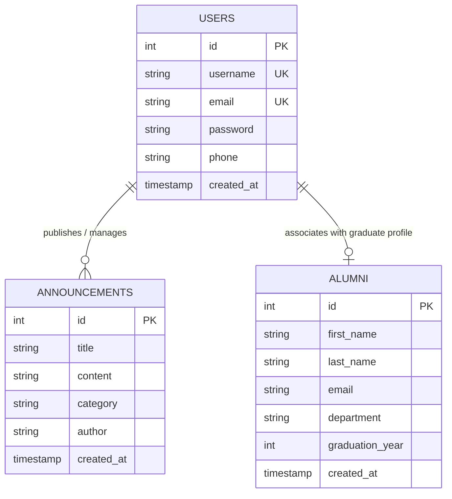

# Data Design Documentation (DDD)

## 📌 1. Overview & Scope

This document specifies the **Data Design Documentation (DDD)** for the **Alumni Management System**. It outlines the conceptual, logical, and physical data architecture, relational schemas, entity relationships, integrity constraints, and persistence strategies.

---

## 🏗️ 2. Storage & Persistence Architecture

The system utilizes a containerized relational database architecture designed for high integrity and durable storage across application lifecycles.

```
┌────────────────────────────────────────────────────────┐
│                   APPLICATION TIER                     │
│  Express.js Engine ──► MVC Controller ──► Data Models  │
└───────────────────────────┬────────────────────────────┘
                            │ SQL Queries (mysql2 pool)
┌───────────────────────────▼────────────────────────────┐
│                    DATABASE TIER                       │
│  MySQL 8.0 Engine (InnoDB)                             │
│  Database Name: alumni_db                              │
└───────────────────────────┬────────────────────────────┘
                            │ Persistent Block Storage
┌───────────────────────────▼────────────────────────────┐
│                    STORAGE TIER                        │
│  Docker Volume: db_data (/var/lib/mysql)               │
│  * Ensures complete non-volatile data persistence       │
└────────────────────────────────────────────────────────┘
```

- **Database Engine:** MySQL 8.0 (InnoDB storage engine supporting ACID transactions and relational constraints).
- **Persistence Mechanism:** Named Docker volume (`db_data`) mapped to `/var/lib/mysql` guarantees permanent data retention across container lifecycle events.
- **Connection Management:** Connection pool (`mysql2/promise`) configured with environment-based configuration parameters.

---

## 🗄️ 3. Entity Definitions & Schema Specifications

The database schema consists of three primary tables: `users`, `alumni`, and `announcements`.

### 3.1. Users Entity (`users` table)
Maintains user credentials, administrative accounts, and contact identities.

| Column Name | Data Type | Key / Constraint | Description |
|---|---|---|---|
| `id` | `INT` | `PK`, `AUTO_INCREMENT` | Unique numeric identifier for the user |
| `username` | `VARCHAR(50)` | `NOT NULL`, `UNIQUE` | Unique user handle / authentication username |
| `email` | `VARCHAR(150)` | `NOT NULL`, `UNIQUE` | Unique email address for communication |
| `password` | `VARCHAR(255)` | `NOT NULL` | Hashed password string |
| `phone` | `VARCHAR(20)` | `NULL` | Optional contact telephone number |
| `created_at` | `TIMESTAMP` | `DEFAULT CURRENT_TIMESTAMP` | System record creation timestamp |

### 3.2. Alumni Entity (`alumni` table)
Maintains graduate records, departments, and academic completion milestones.

| Column Name | Data Type | Key / Constraint | Description |
|---|---|---|---|
| `id` | `INT` | `PK`, `AUTO_INCREMENT` | Unique identifier for alumni record |
| `first_name` | `VARCHAR(100)` | `NOT NULL` | Legal first name of graduate |
| `last_name` | `VARCHAR(100)` | `NOT NULL` | Legal last name of graduate |
| `email` | `VARCHAR(150)` | `NULL` | Contact email address |
| `department` | `VARCHAR(150)` | `NULL` | Academic department of graduation |
| `graduation_year`| `INT` | `NULL` | Four-digit calendar year of graduation |
| `created_at` | `TIMESTAMP` | `DEFAULT CURRENT_TIMESTAMP` | System registration timestamp |

### 3.3. Announcements Entity (`announcements` table)
Maintains institutional bulletins, career notices, and alumni networking announcements.

| Column Name | Data Type | Key / Constraint | Description |
|---|---|---|---|
| `id` | `INT` | `PK`, `AUTO_INCREMENT` | Unique identifier for announcement |
| `title` | `VARCHAR(200)` | `NOT NULL` | Headline / subject of announcement |
| `content` | `TEXT` | `NOT NULL` | Full body text of the bulletin |
| `category` | `VARCHAR(50)` | `NOT NULL` | Categorization: `General`, `Event`, `Career`, `Mentorship` |
| `author` | `VARCHAR(100)` | `NOT NULL` | Publishing entity, office, or individual |
| `created_at` | `TIMESTAMP` | `DEFAULT CURRENT_TIMESTAMP` | Publication timestamp |

---

## 📊 4. Entity-Relationship Diagram (ERD)



---

## 🛡️ 5. Data Integrity & Constraint Rules

1. **Entity Integrity:**
   - Every table mandates an auto-incrementing surrogate primary key (`id`) guaranteeing unique tuple access.
2. **Domain Integrity:**
   - `users.email` and `alumni.email` adhere to standard RFC-compliant electronic mail format.
   - `alumni.graduation_year` accepts valid numeric integer values representing calendar years.
   - `announcements.category` is constrained to defined domain values (`General`, `Event`, `Career`, `Mentorship`).
3. **Uniqueness Constraints:**
   - Both `username` and `email` columns in `users` carry unique index constraints to prevent duplicate credentials.
4. **Mandatory Field Constraints:**
   - Critical descriptive attributes (`username`, `email`, `password`, `first_name`, `last_name`, `title`, `content`) enforce `NOT NULL` constraints.

---

## 🔄 6. Data Access Patterns (CRUD Operations)

| Operation | Entity | Endpoint / Interface | Storage Action |
|---|---|---|---|
| **Create** | User | `POST /users`, `POST /api/users` | `INSERT INTO users (...)` |
| **Read (All)** | User | `GET /users`, `GET /api/users` | `SELECT * FROM users ORDER BY id` |
| **Read (One)** | User | `GET /api/users/:id` | `SELECT * FROM users WHERE id = ?` |
| **Update (Full)** | User | `PUT /api/users/:id` | `UPDATE users SET ... WHERE id = ?` |
| **Update (Partial)** | User | `PATCH /api/users/:id` | `UPDATE users SET [field] = ? WHERE id = ?` |
| **Delete** | User | `POST /users/:id/delete`, `DELETE /api/users/:id` | `DELETE FROM users WHERE id = ?` |
| **Create** | Announcement | `POST /announcements`, `POST /api/announcements` | `INSERT INTO announcements (...)` |
| **Read (All)** | Announcement | `GET /announcements`, `GET /api/announcements` | `SELECT * FROM announcements ORDER BY created_at DESC` |
| **Update** | Announcement | `POST /announcements/:id/update`, `PUT /api/announcements/:id` | `UPDATE announcements SET ... WHERE id = ?` |
| **Delete** | Announcement | `POST /announcements/:id/delete`, `DELETE /api/announcements/:id` | `DELETE FROM announcements WHERE id = ?` |
